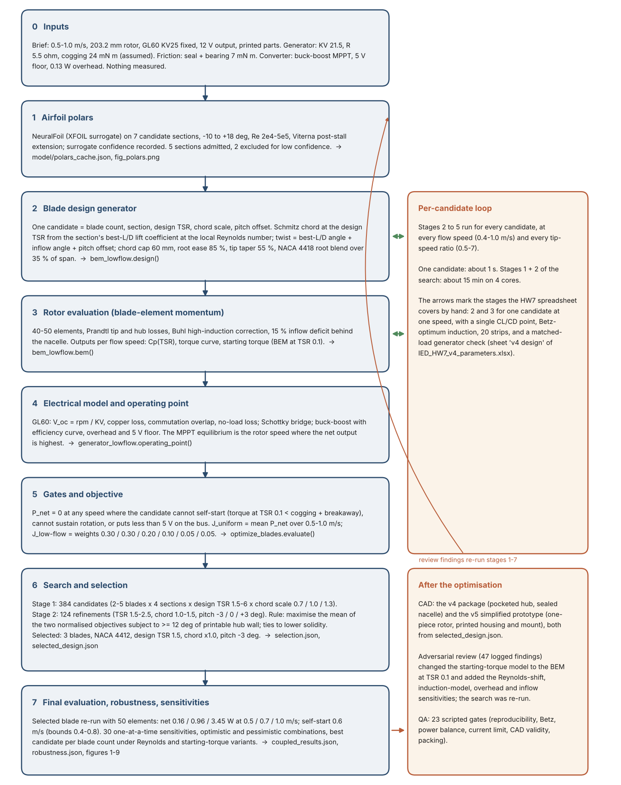

# Blade Optimization Workflow

<p class="sub">8-inch hydrokinetic turbine for 0.5-1.0 m/s streams with the CubeMars GL60 KV25. How the blade geometry was arrived at, stage by stage,
and where the HW7 spreadsheet method fits. Every count and number is read from the v4 result files by <code>docs/make_workflow_doc_v4.py</code>.
Nothing has been measured.</p>

## 1. The workflow at a glance

<figure><figcaption>Figure 1. The optimisation workflow. Stages 2-5 form the inner loop that is run for every candidate, flow speed and tip-speed ratio;
the spreadsheet is the hand-calculable version of stages 2-3 for a single candidate at a single speed.</figcaption></figure>

## 2. The stages

| # | stage | what goes in | what comes out | file |
|---|---|---|---|---|
| 0 | Inputs | brief (0.5-1.0 m/s, 203.2 mm, GL60 fixed, 12 V, printed), generator and converter constants, friction estimates | the assumption set, carried through every stage | `feasibility.json` (assumptions block) |
| 1 | Airfoil polars | UIUC coordinates of 7 sections | CL, CD tables over angle and Reynolds number with surrogate confidence; 2 sections excluded | `polars.py` -> `polars_cache.json` |
| 2 | Design generator | blade count, section, design TSR, chord scale, pitch offset | chord and twist at 40-50 radial stations | `bem_lowflow.design()` |
| 3 | Rotor evaluation | the blade, flow speed | Cp and torque against tip-speed ratio, starting torque | `bem_lowflow.bem()` |
| 4 | Electrical model | torque curve, generator, rectifier, converter | the MPPT operating point: rpm, bus voltage, current, net power | `generator_lowflow.operating_point()` |
| 5 | Gates and objective | per-speed net power, self-start and sustain checks | J_uniform and J_low-flow for the candidate | `optimize_blades.evaluate()` |
| 6 | Search and selection | 384 stage-1 and 124 stage-2 candidates | ranked list, the selected design, the unconstrained and hand-started alternatives | `optimize_blades.py 1`, `optimize_blades.py 2` -> `selection.json`, `selected_design.json` |
| 7 | Final evaluation | the selected design, the two previous blades | power curves, comparison table, 30 sensitivities, bounds, robustness per blade count | `coupled_eval.py`, `robustness_v4.py` |
| 8 | Downstream | the station table | CAD (v4, v5), review, QA gates, reports | `cad/`, `docs/` |

## 3. What each stage decides

- **Stage 1 fixes which sections can be trusted.** The surrogate's confidence is part of the data; E818 and E387 were left out rather than
  guessed. This is where the Reynolds-number dependence enters: every later stage reads CL and CD at the local Reynolds number.
- **Stage 2 turns five numbers into a blade.** The Schmitz chord is the same formula as in the HW7 sheet; the workflow adds the chord cap,
  the root ease, the tip taper, the root blend and the station-by-station best-L/D angle.
- **Stage 3 is where the design TSR and the operating TSR separate.** The sheet evaluates a blade at its design TSR with Betz-optimum
  induction; the BEM evaluates the whole Cp(TSR) curve with iterated induction, so a blade designed at TSR 1.5 can be run at TSR 2.8.
- **Stage 4 is why Cp alone was not the objective.** The generator's voltage, copper loss and the converter's floor and overhead decide
  how much of the shaft power reaches the battery; the operating point is where that net power peaks, not where Cp peaks.
- **Stage 5 is where self-start enters.** A candidate that cannot overcome cogging plus breakaway at a speed scores nothing there.
  This single gate removed every high-TSR design from contention.
- **Stage 6 found a flat optimum.** The eight best stage-2 candidates lie within 1.5 % of each other; a packaging rule (printable hub wall)
  made the final pick. The selected blade: 3 blades, NACA 4412, design TSR 1.5, chord x1.0, pitch -3 deg.
- **Stage 7 says how sure we are.** Net output 0.16 / 0.96 / 3.45 W at 0.5 / 0.7 / 1.0 m/s; self-start 0.6 m/s with bounds
  0.4-0.8 m/s; the dominant uncertainties are the transition Reynolds number of a printed surface and the cogging torque.

## 4. Where the HW7 spreadsheet sits

The workbook `IED_HW7_v4_parameters.xlsx` (sheet "v4 design") is the hand-calculable form of stages 2 and 3 for one candidate at one speed,
plus a matched-load generator check. With the v4 inputs it reproduces the planform family of the selected blade from the same Schmitz formula.
What it cannot do, and what the workflow added:

| HW7 sheet | workflow |
|---|---|
| one CL, CD at one Reynolds number | tables over angle and Reynolds number for 7 sections, confidence-filtered |
| Betz-optimum induction in closed form (a, a' from phi) | induction iterated per element from the polars (Ning residual, Buhl correction) |
| the blade evaluated at its design TSR only | the full Cp(TSR) curve at every speed from 0.4 to 2.0 m/s |
| generator check: maximum power into a matched load | MPPT equilibrium with copper loss, commutation drop, diode drop, converter efficiency, overhead and floor |
| one candidate, one speed | 508 candidates x 7 speeds x 14-36 tip-speed ratios, gated on self-start |
| pass / fail against a required power | two weighted energy objectives, a packaging rule, robustness and sensitivity studies |

The spreadsheet was not an input to the optimisation; its method is the seed of stage 2, and it is a useful one-page check of any
candidate's chord and twist.

## 5. Re-running the workflow

```
python model/polars.py && python model/optimize_blades.py 1 && python model/optimize_blades.py 2 && python model/feasibility.py
python model/coupled_eval.py && python model/robustness_v4.py && python cad/make_v4.py && python cad/views_v4.py
python model/structure_v4.py && python tools/qa_gates_v4.py && python docs/make_report_v4.py
```
Stage 1 of the sweep takes about 10 minutes on 4 cores; everything downstream of `selected_design.json` regenerates from it, including the
v5 simplified CAD (`cad/turbine_simple_v5/make_v5.py`).
