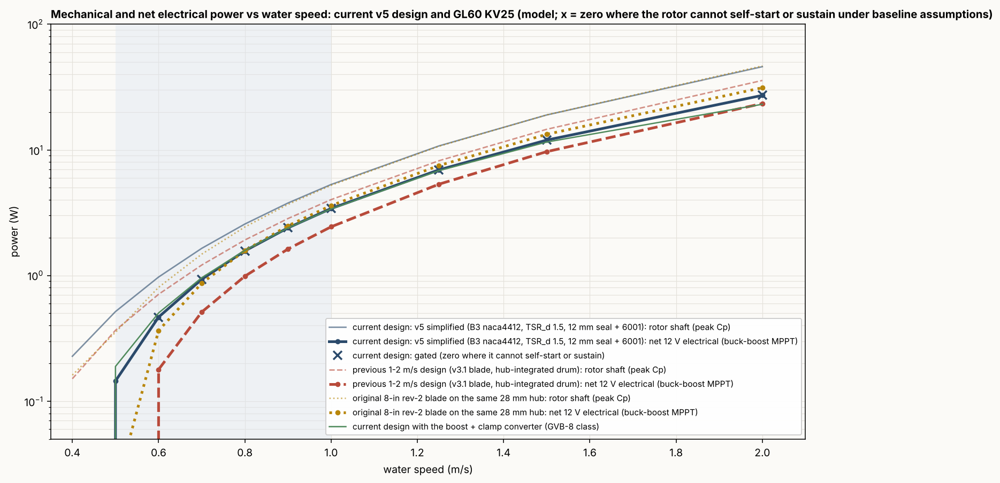
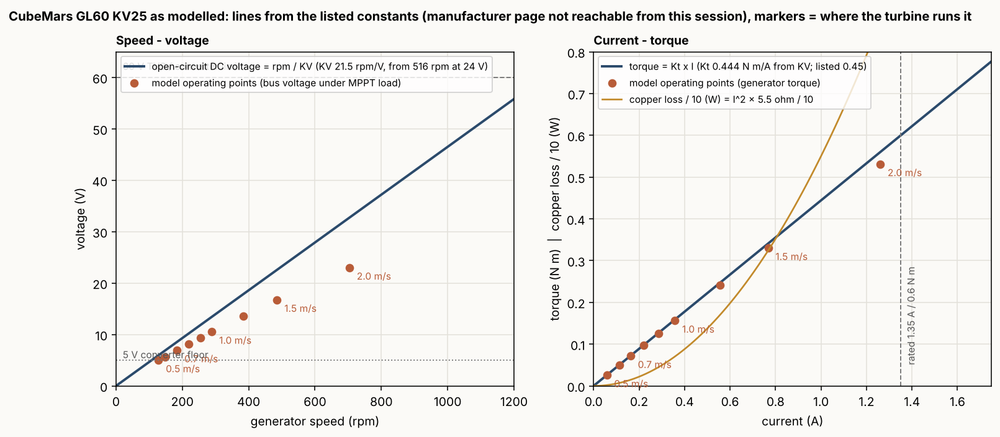
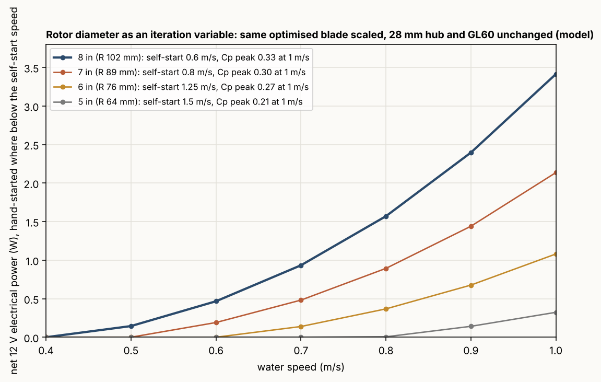

# Low-Flow Turbine: Design Summary (current design)

8-inch hydrokinetic turbine for 0.5-1.0 m/s streams, CubeMars GL60 KV25, v5 simplified prototype with the v4 optimised blade.
Model predictions only; nothing has been built or measured. Generated by <code>make_summary_v5.py</code> from the result files.

## 1. Current design and predicted output

| | |
|---|---|
| Rotor | 3 blades, NACA 4412 to 4418 root, design TSR 1.5, pitch -3 deg, chord 50 / 60 / 31 mm (hub / max / tip), Ø203.2 mm, hub Ø56 |
| Assembly | one-piece printed rotor, printed housing (one 12 mm lip seal + one 6001 bearing), printed mount = rear lid + stake socket, small bell adapter; GL60 dry inside |
| Net 12 V output at 0.5 / 0.7 / 1.0 / 2.0 m/s | 0.14 / 0.93 / 3.41 / 27.2 W |
| Self-start / sustain | 0.6 / 0.5 m/s (hand spin covers 0.5 m/s) |
| Operating speed, current, bus voltage at 0.7 m/s | 184 rpm, 0.16 A, 7.0 V |
| Open-circuit at 2 m/s | 46 V (below the 60 V limit) |
| Depth | 91 mm nose to lid; packs as rotor 59 mm + housing/mount 76 mm |

<figure><figcaption>Figure 1. Mechanical and net electrical power against water speed for the current design, the original rev-2 blade and the v3.1 drum design. Crosses: zero where the current design cannot self-start or sustain.</figcaption></figure>

## 2. Motor: listed data and how we run it

| CubeMars GL60 KV25 (listed) | value |
|---|---|
| rated voltage / power | 24 V / 20 W |
| rated torque / current / speed | 0.6 N m / 1.35 A / 310 rpm (one reseller: 350 rpm / 1.43 A) |
| peak torque / current | 1.75 N m / 4 A |
| no-load speed | 516 rpm at 24 V -> KV 21.5 rpm/V (we use this; the "KV25" name is a different convention) |
| resistance / inductance | 5.5 ohm / 2.72 mH |
| pole pairs, mass, size | 14, 230 g, 69 x 22.3 mm |
| bore, rating | 20 mm hollow shaft (most listings; the encoder variant is listed with 6 mm), IP45 per reseller listings only (not submersible either way: the housing keeps it dry) |

Source: the CubeMars specification table as returned by web search (cubemars.com product and goods pages; reseller listings agree except one
outlier quoting 1140 rpm). The manufacturer page could not be fetched directly from this session. No current-speed curve is published; Figure 2
draws the lines the model uses from the listed constants and marks where the turbine runs the motor. The generator is used far below its
ratings: 0.36 A at 1 m/s, 1.26 A at 2 m/s against 1.35 A rated; the 1.75 N m peak is a motoring figure, not a generating one.

<figure><figcaption>Figure 2. GL60 KV25 as modelled: open-circuit voltage = rpm / KV, torque = Kt x I with Kt = 0.444 N m/A, copper loss I^2 R; markers are the model's operating points from 0.5 to 2 m/s.</figcaption></figure>

## 3. Assumptions made during development

- Water 1000 kg/m3, 1.0e-6 m2/s; uniform inflow; a 15 % inflow deficit inboard of r 38 mm behind the housing (reviewer's estimate 0.6-0.75, carried as a sensitivity).
- Airfoil polars from NeuralFoil (XFOIL surrogate), not measurements; wet printed-surface transition unknown (Re x/÷1.5 sensitivity).
- Generator: KV 21.5 from the listed no-load speed, R 5.5 ohm, cogging 24 mN m (assumed; the single largest unknown for self-start), no-load loss 0.5 W at 700 rpm, hole patterns PCD 40 (bell) / 50 (base), 20 mm bore.
- Friction: 12 mm PTFE lip seal 6 mN m running / 12 breakaway, 6001 bearing 3 / 4 mN m.
- Electronics: Schottky bridge (0.30 V + 0.20 ohm per diode), buck-boost MPPT with 94 % peak efficiency, 0.13 W fixed overhead, 5 V input floor, never more than 1.35 A drawn.
- Starting torque = BEM torque at TSR 0.1 with induction (the no-induction estimate, 1.8x higher, is an upper bound only).
- Printed ASA allowables 8 MPa long-term wet; thrust goes through the GL60 bearings in v5 (axial play to be checked).

## 4. The HW7 spreadsheet: how it worked and what it did

The sheet is a 20-strip Betz-optimum blade calculator: design TSR, Schmitz chord 8 pi r (1 - cos phi) / (B CL), twist = phi - alpha, closed-form induction,
Prandtl tip and hub losses, torque summed over the strips, then a matched-load generator check (E = Ke x omega, P = (E - 2 Vf)^2 / 4R) against a
required power and a minimum bus voltage. With the v4 inputs (sheet "v4 design" of `IED_HW7_v4_parameters.xlsx`) it gives Cp 0.30 and a chord within
2.3 mm and a twist within 1.1 deg of the optimised blade over the span (the tip taper is the only difference).

What it fixed in the outcome, and what it could not:

| the sheet decided | the sheet could not see, so the workflow added |
|---|---|
| the design method itself: Schmitz planform + best-L/D twist at a design TSR | Reynolds-dependent polars for 7 sections (one CL/CD point in the sheet) |
| that the generator voltage, not the rotor, is the low-speed limiter: at the design TSR the sheet reports E = 4.6 V < 5 V floor and FAIL | the operating point from the generator load (TSR 2.8, 6.9 V at 0.7 m/s) instead of the design TSR |
| the pass/fail logic: power, torque and voltage checks against the motor | self-start gating against cogging + breakaway, which removed every design TSR >= 3 |
| | iterated induction per element, Buhl correction, 508 candidates x 7 speeds, two energy objectives, robustness and sensitivity studies |

The sheet was not an input file to the optimisation; it is the one-page hand version of stages 2-3 of the workflow and the cross-check of the result.

## 5. How we iterated

1. **Original 8-in rev-2 blade** (1-2 m/s design, TSR 4): 0.02 / 0.87 / 3.61 W at 0.5 / 0.7 / 1.0 m/s on the same hub, self-start 0.7 m/s.
2. **v3.1 drum design** (motor inside a 48 mm hub): 0.00 / 0.51 / 2.44 W, self-start 1.0 m/s; the hub ratio costs 44-77 % at 0.7-1.0 m/s, so the small hub ahead of the housing was kept.
3. **v4 low-flow optimisation**: 384 stage-1 + 124 stage-2 candidates, two objectives, self-start gate, packaging rule; adversarial review (three reviewers, 47 findings) changed the starting-torque model and added five sensitivities; the search was re-run and the pick moved from design TSR 2.0 x1.3 to TSR 1.5 x1.0.
4. **v5 simplification**: same blade; shaft, collars, circlips, clamp ring and machined caps replaced by three printed parts and one adapter; cost 3 % at 0.7 m/s for the 12 mm seal.
5. **Diameter as an iteration variable** (Figure 3, same blade scaled, hub and motor fixed): smaller is worse than the area ratio because chord Reynolds number, hub ratio and fixed losses all move the wrong way, and the starting torque falls as D^3 against a fixed 40 mN m breakaway (cogging + seal + bearing).

| diameter | net W at 0.5 / 0.7 / 1.0 m/s | self-start (m/s) | Cp peak at 1 m/s | starting torque at 0.5 m/s (mN m) | thrust at 2 m/s (N) |
|---|---|---|---|---|---|
| 8 in | 0.14 / 0.93 / 3.41 | 0.6 | 0.327 | 29 vs 40 | 38 |
| 7 in | 0.00 / 0.48 / 2.14 | 0.8 | 0.301 | 18 vs 40 | 30 |
| 6 in | 0.00 / 0.14 / 1.08 | 1.25 | 0.266 | 10 vs 40 | 22 |
| 5 in | 0.00 / 0.00 / 0.32 | 1.5 | 0.211 | 5 vs 40 | 15 |

<figure><figcaption>Figure 3. Rotor diameter study. 8 in is the smallest diameter that produces anything useful at the low end with this generator.</figcaption></figure>

## 6. Foil, blade count, final pick

- **Foil:** NACA 4412 (L/D 10 / 49 / 79 at Re 4e4 / 8e4 / 2e5) beat the higher-lift SG6043 and FX 63-137 in the coupled result (1.51 vs 1.36 and 1.34 W mean net power): their higher design lift coefficient gives narrower chords, lower Reynolds number and a sharper Cp peak. E818 and E387 were excluded for low surrogate confidence. NACA 4418 at the root for printability.
- **Blade count:** best 2 / 3 / 4 / 5-blade candidates score 1.40 / 1.51 / 1.51 / 1.47 W and start at 0.7 / 0.6 / 0.6 / 0.5 m/s: two blades start late, five lose Cp to drag; three is the compromise within a few percent of four.
- **Final pick:** the highest mean of the two normalised objectives among candidates with a printable hub wall; it self-starts from 0.6 m/s (29 vs 40 mN m at 0.5 m/s in the v5 arrangement), has the highest output at 0.5-0.7 m/s once turning, and stays within 5 % of the original blade at 0.8-1.0 m/s. The eight best candidates were within 1.5 % of each other.

## 7. Assembly check (current CAD)

Assembly STEP `out/v5_assembly.step`: 32 parts; all printed parts valid single solids: True; all parts single solids: True;
rigid-part clash check over 465 pairs: none; seal lip overlap as modelled: True; STLs watertight: True.
The NX archive supplied (`updated_nx_parts.zip`) holds the same 32 part names plus the assembly as Siemens NX `.prt` conversions of these STEP files; NX
geometry cannot be read in this environment, so the check above is on the STEP source.

## 8. What to measure first

GL60 cogging torque and the DC voltage per rpm through a bridge; seal and bearing friction; rotor starting torque at 0.5-0.7 m/s with the shaft locked;
the power curve. These replace the four assumptions that set the 0.5-0.7 m/s numbers.
